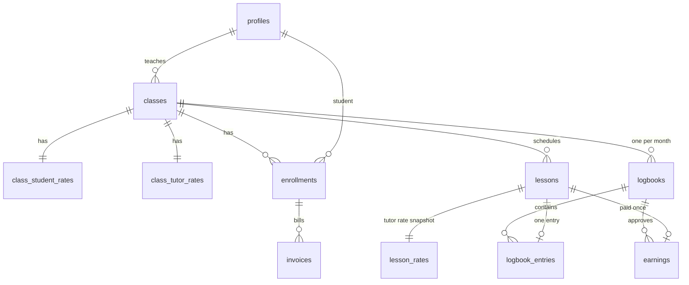

# Architecture

Next.js renders the three role areas and calls PostgreSQL (Supabase) as the signed-in user. Business rules live in the database, so they hold even for direct API calls ([ADR 0001](docs/adr/0001-business-rules-in-postgres.md)).

```
Browser → Server Component / Server Action (zod) → Supabase API as the user → SQL function / RLS-filtered select → tables
```

`docker compose up` runs it all: `web` (Next.js) → `gateway` (nginx) → `auth` (GoTrue) and `rest` (PostgREST) → `db` (Postgres), with `migrate` applying the schema and seed first ([ADR 0006](docs/adr/0006-docker-compose-stack.md)).

## Data model



Derived, not stored: `hour_ledger` and `enrollment_balances` (purchases minus delivered lessons, [ADR 0003](docs/adr/0003-derived-hour-ledger.md)). `class_catalog` is the student storefront.

## Where each rule is enforced

| Rule | Enforced by |
| --- | --- |
| No duplicate enrollment | partial unique index on `(class_id, student_id)` and a check in `enroll()` |
| Capacity | `enroll()` locks the class row before counting seats; `update_class()` refuses a lower capacity |
| End after start, max 8h, whole minutes | `check` constraints on `lessons` |
| Tutor lessons cannot overlap | exclusion constraint on `(tutor_id, time range)` for scheduled lessons |
| One logbook per class per month, one entry per lesson | `unique (class_id, month)` and `unique (lesson_id)` |
| Entry only for an ended, non-cancelled lesson of that month | trigger `guard_logbook_entry` |
| Approved logbook is read-only | same trigger plus status guards in the functions |
| Recurring lessons are all or nothing | `schedule_lessons_weekly()` runs every date through the same `private.add_lesson()` as a single lesson, inside one transaction |
| Only admins approve; approving twice adds nothing | role check and `for update` status guard in `approve_logbook()`, `unique (lesson_id)` on `earnings` |
| Students only see paid classes; logbooks hidden until approved | RLS policies using `private` helper functions |
| Tutors never see student rates; only admin and the tutor see earnings | rates and earnings in separate tables with their own policies, [ADR 0002](docs/adr/0002-visibility-with-rls.md) |
| A payment proof is optional; only the owner adds one to an unpaid invoice; only the owner and admins read it | private bucket with storage policies, `attach_payment_proof()`, [ADR 0010](docs/adr/0010-payment-proofs-in-private-storage.md) |
| Who approved a payment | `invoices.paid_by`, shown through the `invoice_approvals` view that exposes only the name |
| Only the write paths above exist | `insert/update/delete` revoked from `anon` and `authenticated` |

pgTAP tests in `supabase/tests/database` impersonate each seeded user to prove these rules.

## Application structure

- `app/admin`, `app/tutor`, `app/student`: one route group per role. Each layout calls `requireRole()`; pages read data with the user's session.
- Server Actions are one-liners over `rpcAction()` (`lib/action.ts`): validate with zod, call one database function, translate database errors into plain messages.
- Payment proofs are uploaded by a Server Action with the student's own session and shown through the route handler `app/proofs/[invoiceId]/route.ts`, which reads under row level security. The browser never calls storage.
- `proxy.ts` only refreshes the session cookie and redirects visitors who are not signed in.
- The calendar (`components/calendar`) is server-rendered and its state lives in the URL (`view`, `date`, filters, and `lesson`, `add` or `repeat` for the dialog that is open), see [ADR 0007](docs/adr/0007-calendar-state-in-the-url.md).

## Design system

- Tokens live in `app/globals.css` under `@theme`: navy `#2F3F5F`, gold `#F1C019`, surface `#FAFDFF`, cloud `#E0E2E7`, muted `#6E7585`, success `#0AB848`, danger `#FF2819`, 6px card radius, DM Sans. Darker `-ink` variants of success, danger and gold are used for small text to keep contrast readable.
- `components/ui` is a small hand-written kit: `Button`, `Card`, `Table`, `Badge` / `StatusBadge` (one place maps every status to a label, tone and icon), `Field` controls, `Alert`, `EmptyState`, `Stat`, `HoursMeter`, and the calendar parts (`ScheduleCalendar`, `WeekStrip`).
- `Combobox` replaces native selects: searchable, with either a fixed list or options loaded one page at a time while you scroll ([ADR 0008](docs/adr/0008-combobox-with-paged-options.md)).
- `DatePicker`, `TimePicker` and `NumberInput` complete the set of fields, built on the same popover panel as the combobox (`components/ui/picker.tsx`, [ADR 0009](docs/adr/0009-date-time-and-number-fields.md)). Dates stay `YYYY-MM-DD` and times 24-hour `HH:mm` (WIB), and rates show an `Rp` prefix, thousands separators and steps of Rp10.000. They submit plain values, so the server-side validation is unchanged.
- `Table` scrolls sideways when it is wider than the screen. A cell marked `sticky` (the actions column) stays pinned at the right edge from tablet width up, with a shadow while other columns slide beneath it. On phones it scrolls with the row, because the buttons would take most of the screen.
- Mutations use two patterns: `ActionForm` (inline, shows errors) and `DialogForm` (a confirmation or short form in a native `<dialog>`).
- `components/layout`: one `AppShell` shared by all roles. The desktop sidebar is pinned to the viewport height, so only the content scrolls; on phones there is a sticky header and bottom tabs.
- Copy is plain English, every action has an icon and a visible label, and money and hours are always formatted through `lib/format.ts` (rupiah, `1h 30m`, WIB).
