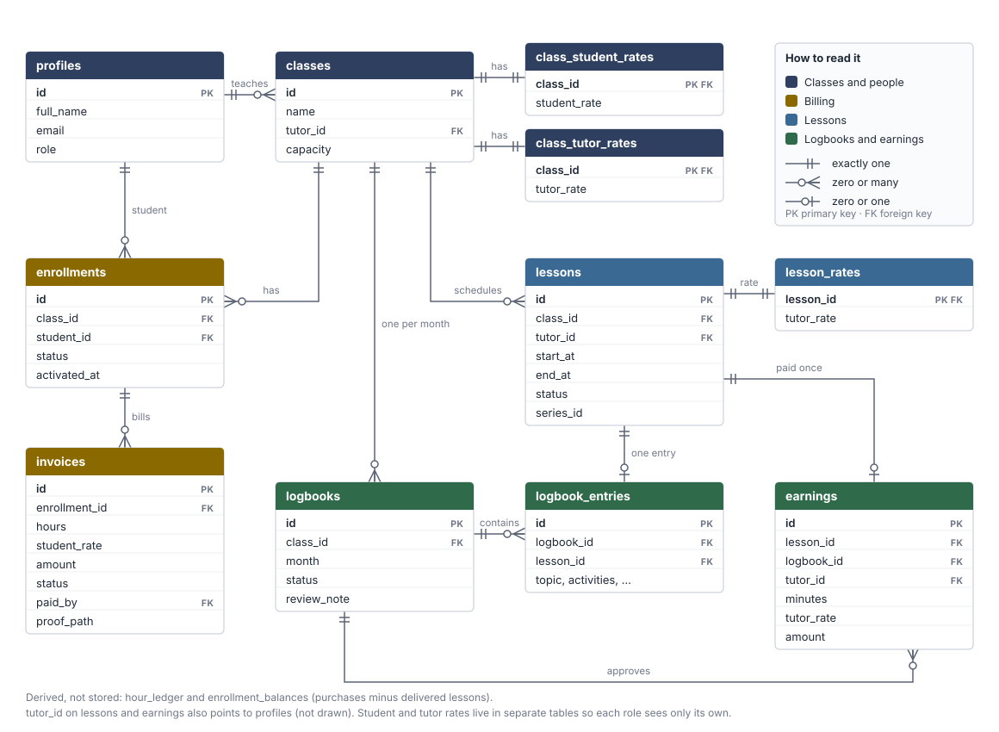

# Architecture

Next.js renders the three role areas and calls Postgres (Supabase) as the signed-in user. Business rules live in the database, so they hold even for direct API calls ([ADR 0001](docs/adr/0001-business-rules-in-postgres.md)).

```
Browser → Server Component / Server Action (zod) → Supabase API as the user → SQL function or RLS-filtered select → tables
```

`docker compose up` runs it: `web` → `gateway` (nginx) → `auth`, `rest`, `storage` → `db`, with `migrate` applying schema and seed first ([ADR 0006](docs/adr/0006-docker-compose-stack.md)).

## Data model



## Where each rule is enforced

| Rule                                                                                                                    | Enforced by                                                                                                                            |
| ----------------------------------------------------------------------------------------------------------------------- | -------------------------------------------------------------------------------------------------------------------------------------- |
| No duplicate enrollment; capacity                                                                                       | partial unique index; `enroll()` locks the class row; `update_class()` refuses a lower capacity                                        |
| Lesson is valid (ends after start, max 8h, whole minutes); a tutor's lessons never overlap                              | `check` constraints; exclusion constraint on `(tutor_id, time range)`                                                                  |
| One logbook per class and month; one entry per lesson, only for an ended lesson of that month                           | `unique` constraints; trigger `guard_logbook_entry`                                                                                    |
| Approved logbook is read-only; only admins approve; approving twice adds nothing                                        | status guards in the functions and trigger; role check and `for update`; `unique (lesson_id)` on `earnings`                            |
| Recurring lessons are all or nothing                                                                                    | `schedule_lessons_weekly()` runs every date through `private.add_lesson()` in one transaction                                          |
| Students see paid classes and approved logbooks only; tutors never see student rates; earnings are admin and tutor only | RLS with `private` helper functions; rates and earnings in separate tables ([ADR 0002](docs/adr/0002-visibility-with-rls.md))          |
| Only admins mark invoices paid, and who approved is recorded                                                            | `mark_invoice_paid()`; `invoices.paid_by` shown through the `invoice_approvals` view                                                   |
| Proof of payment is optional; only the owner uploads; only the owner and admins read                                    | private bucket policies and `attach_payment_proof()` ([ADR 0010](docs/adr/0010-payment-proofs-in-private-storage.md))                  |
| A paid invoice can be cancelled only while its hours are unused, and the button says so up front                        | `void_invoice()` for the rule; `invoice_list.can_cancel` for the early answer                                                          |
| Lists stay fast with thousands of rows                                                                                  | flat `security_invoker` views, trigram and foreign key indexes ([ADR 0011](docs/adr/0011-lists-searched-and-paged-in-the-database.md)) |
| Only these write paths exist                                                                                            | `insert`, `update`, `delete` revoked from `anon` and `authenticated`                                                                   |

pgTAP tests in `supabase/tests/database` impersonate each seeded user to prove these rules.

## Application structure

- `app/admin`, `app/tutor`, `app/student`: one route group per role; each layout calls `requireRole()`.
- Server Actions are one-liners over `rpcAction()`: validate with zod, call one database function, turn database errors into plain messages. Payment proofs go through a Server Action and a route handler that reads under RLS, so the browser never calls storage.
- Calendar and list state lives in the URL, so every view is a link ([ADR 0007](docs/adr/0007-calendar-state-in-the-url.md), [0011](docs/adr/0011-lists-searched-and-paged-in-the-database.md)). `proxy.ts` only refreshes the session and redirects visitors who are not signed in.

## Design system

- **Tokens** in `app/globals.css` under `@theme`: navy, gold, surface, cloud, muted, success, danger, 6px radius, DM Sans. Darker `-ink` variants keep small text readable.
- **`components/ui`** is a small hand-written kit: `Button`, `Card`, `Table` (pinned actions column), `StatusBadge` (one place maps every status to a label, tone and icon), `Alert`, `EmptyState`, `Stat`, `HoursMeter`. Fields share one popover panel: `Combobox`, `DatePicker`, `TimePicker`, `NumberInput` ([ADR 0008](docs/adr/0008-combobox-with-paged-options.md), [0009](docs/adr/0009-date-time-and-number-fields.md)).
- **`components/list`** (`ListToolbar`, `Pagination`, `NoResults`) and **`components/calendar`** are the two larger patterns; `ActionForm` and `DialogForm` cover mutations; `AppShell` is shared by all roles (pinned sidebar, bottom tabs on phones).
- **Copy** is plain English, every action has an icon and a visible label, and money, hours and time always go through `lib/format.ts` (rupiah, `1h 30m`, WIB).
