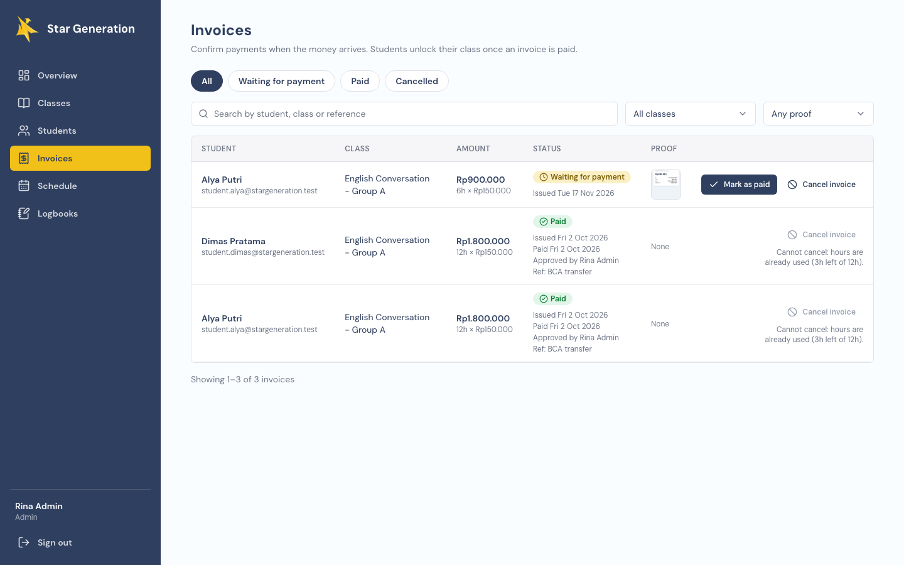
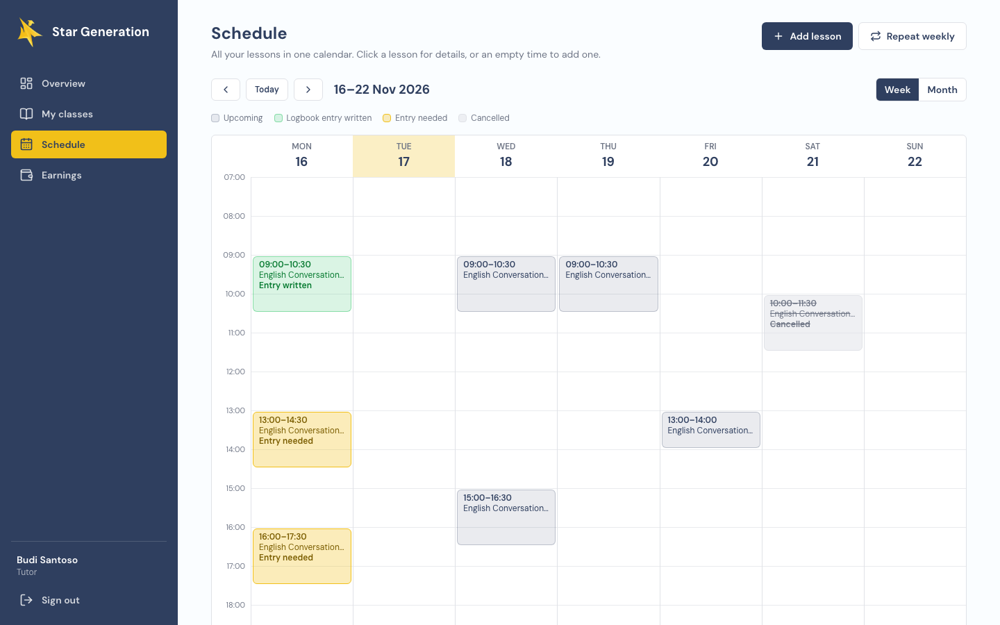
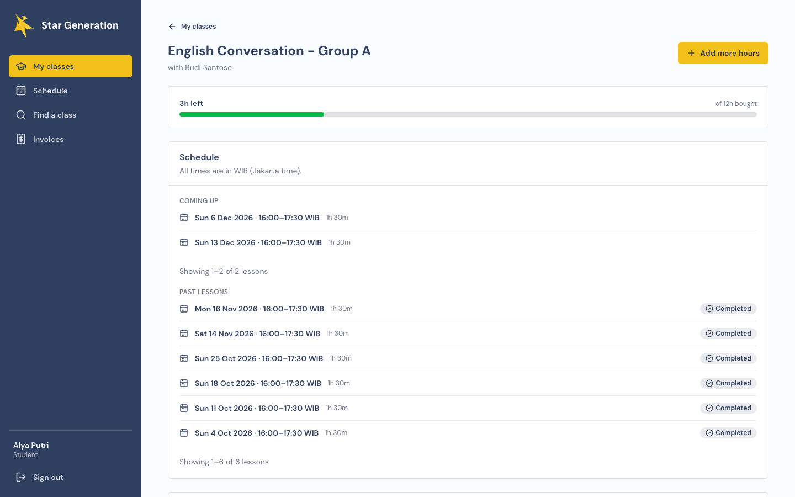

# Star Generation: Group Class Enrollment & Billing

Role-based web app for group classes. Admins run classes, invoices and logbook review. Tutors schedule lessons and write monthly logbooks. Students enroll, pay and follow their progress.

|       |                                                                                                                        |
| ----- | ---------------------------------------------------------------------------------------------------------------------- |
| Stack | TypeScript, Next.js (App Router), Tailwind CSS v4, Supabase (Postgres, Auth, Storage), pnpm workspaces, Docker Compose |
| Rules | Enforced in Postgres (constraints, RLS, functions), covered by pgTAP tests                                             |
| Docs  | [ARCHITECTURE](ARCHITECTURE.md) · [Decisions](docs/DECISIONS.md) · [ADRs](docs/adr) · [Delivery plan](docs/plan.md)    |

## Start here

| Step | Do                                                                                                            |
| ---- | ------------------------------------------------------------------------------------------------------------- |
| 1    | Run `docker compose up --build`, then open http://localhost:3000                                              |
| 2    | Sign in with a [seeded user](#seeded-logins), password `Password123!`                                         |
| 3    | Read [docs/DECISIONS.md](docs/DECISIONS.md) first: it answers each open decision and explains the improvement |
| 4    | [ARCHITECTURE.md](ARCHITECTURE.md) has the data model and where each rule is enforced                         |

|                                   Admin: invoices                                   |                                   Tutor: schedule                                   |                                  Student: class                                  |
| :---------------------------------------------------------------------------------: | :---------------------------------------------------------------------------------: | :------------------------------------------------------------------------------: |
| [](docs/images/admin-invoices.png) | [](docs/images/tutor-schedule.png) | [](docs/images/student-class.png) |

## Run it

Needs only [Docker](https://www.docker.com/products/docker-desktop) with Compose.

```bash
docker compose up --build   # first run takes a few minutes
docker compose down         # stop, keep the data
docker compose down -v      # stop and wipe the data (the seed loads again next start)
```

| Service                                             | Address                                                 |
| --------------------------------------------------- | ------------------------------------------------------- |
| Web app                                             | http://localhost:3000                                   |
| API gateway (`/auth/v1`, `/rest/v1`, `/storage/v1`) | http://localhost:54321                                  |
| Postgres                                            | `localhost:54322`, user `postgres`, password `postgres` |

- The compose file ships public demo values for the database password, JWT secret and the anon and service keys. Override `POSTGRES_PASSWORD`, `JWT_SECRET`, `ANON_KEY` and `SERVICE_ROLE_KEY` to change them (both keys are JWTs signed with the secret).
- Updating from an older checkout: run `docker compose down -v` once, because the storage role is created with the database.

### Develop

Backend in Docker, app on your machine with hot reload. Needs Node.js 22+ and [pnpm](https://pnpm.io) 12. No `.env` file: outside production the app falls back to the local gateway.

```bash
pnpm install
pnpm db:start   # db, auth, storage, migrations, API, gateway
pnpm dev        # http://localhost:3000
```

A production build has no fallback: set `SUPABASE_URL` and `SUPABASE_ANON_KEY` (the compose `web` service does).

## Seeded logins

Password for every account: `Password123!`. There is no sign-up.

| Role    | Name           | Email                               |
| ------- | -------------- | ----------------------------------- |
| Admin   | Rina Admin     | `admin@stargeneration.test`         |
| Tutor   | Budi Santoso   | `tutor.budi@stargeneration.test`    |
| Tutor   | Sari Wulandari | `tutor.sari@stargeneration.test`    |
| Student | Alya Putri     | `student.alya@stargeneration.test`  |
| Student | Dimas Pratama  | `student.dimas@stargeneration.test` |
| Student | Citra Lestari  | `student.citra@stargeneration.test` |

The seed has one class: **English Conversation - Group A**, taught by Budi, capacity 2, student rate Rp150,000/h, tutor rate Rp100,000/h. Three students for two seats shows the capacity rule: the third to enroll is refused.

## Try it

| As   | Do this                                                                      | You see                                                            |
| ---- | ---------------------------------------------------------------------------- | ------------------------------------------------------------------ |
| Alya | **Find a class** → Enroll (pick hours)                                       | An invoice waiting for payment                                     |
| Alya | **Invoices** → Add proof of payment (JPG, PNG or WebP, up to 5 MB, optional) | A thumbnail on the invoice                                         |
| Rina | **Invoices** → Mark as paid                                                  | The proof in the dialog; the class opens; "Approved by Rina Admin" |
| Rina | **Invoices** → Cancel invoice on a paid invoice whose hours were used        | Button disabled, with the reason                                   |
| Budi | **Schedule** → click an empty slot, or **Repeat weekly**                     | One lesson, or a whole series checked together                     |
| Alya | **Schedule**                                                                 | Upcoming lessons her remaining hours no longer cover are flagged   |
| Any  | Any list                                                                     | Search, filters and pages of 20 rows (12 cards)                    |

Logbook walkthrough (needs `pnpm db:demo`):

| Step | Who  | Action                                                                                                                     |
| ---- | ---- | -------------------------------------------------------------------------------------------------------------------------- |
| 1    | Budi | Write entries for the two recent lessons, submit the logbook (every lesson of the month must have ended and have an entry) |
| 2    | Rina | Preview the earnings, approve (or request changes with a note)                                                             |
| 3    | Alya | Read the approved logbook                                                                                                  |

## Optional data

Run with the stack up. Both load on top of the seed. Go back to the plain seed with `docker compose down -v`.

| Command        | Adds                                                                                                                       | Use it to                                                                                                                                   |
| -------------- | -------------------------------------------------------------------------------------------------------------------------- | ------------------------------------------------------------------------------------------------------------------------------------------- |
| `pnpm db:demo` | Alya and Dimas as paying students, last month's approved logbook with earnings, two lessons to log, two lessons next month | Walk through the logbook flow. Dates are relative to today                                                                                  |
| `pnpm db:bulk` | 120 students, 60 classes, about 4,800 invoices, plus lessons, logbooks and earnings                                        | Try search, filters and paging at scale (run `db:demo` first to also give Alya 25 old invoices) (search "Bulk Student 007" on **Invoices**) |

## Commands

| Command                        | What it does                                                |
| ------------------------------ | ----------------------------------------------------------- |
| `pnpm db:test`                 | pgTAP tests for business rules and RLS (in Docker)          |
| `pnpm test`                    | Vitest unit tests                                           |
| `pnpm typecheck` / `pnpm lint` | TypeScript and ESLint                                       |
| `pnpm up` / `pnpm down`        | Shortcuts for `docker compose up --build` and `down`        |
| `pnpm db:start`                | Start only the backend in the background                    |
| `pnpm db:reset`                | Wipe the data and restart the backend with a fresh seed     |
| `pnpm db:types`                | Regenerate `apps/web/src/lib/database.types.ts` (in Docker) |

The [Supabase CLI](https://supabase.com/docs/guides/cli) is optional: `supabase/config.toml` still works with `supabase start` (pass its publishable key as `SUPABASE_ANON_KEY`).

## Repository layout

| Path                  | Holds                                                                  |
| --------------------- | ---------------------------------------------------------------------- |
| `apps/web/`           | Next.js app: `app/` routes per role, `components/`, `lib/`, Dockerfile |
| `supabase/migrations` | Schema, RLS, business-rule functions, list views                       |
| `supabase/tests`      | pgTAP tests                                                            |
| `supabase/*.sql`      | `seed.sql` (required), `demo.sql` and `bulk.sql` (optional)            |
| `docker/`             | Gateway config, role passwords, migrate script                         |
| `docs/`               | Decisions, plan, ADRs                                                  |
